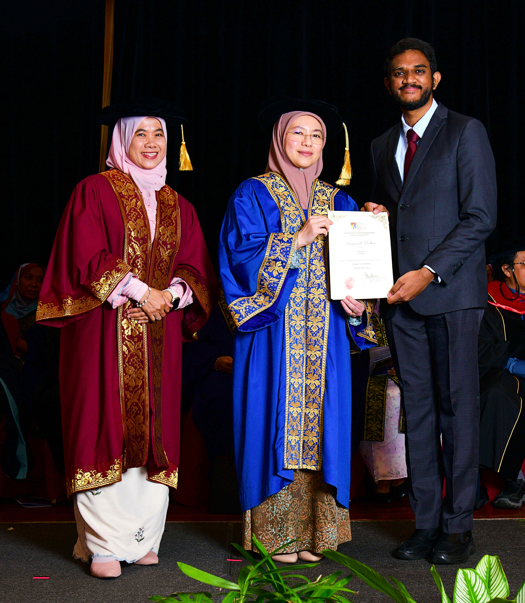
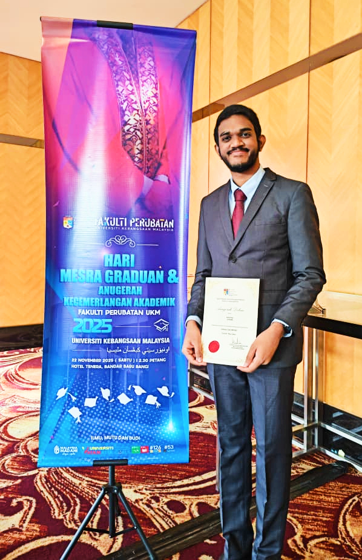
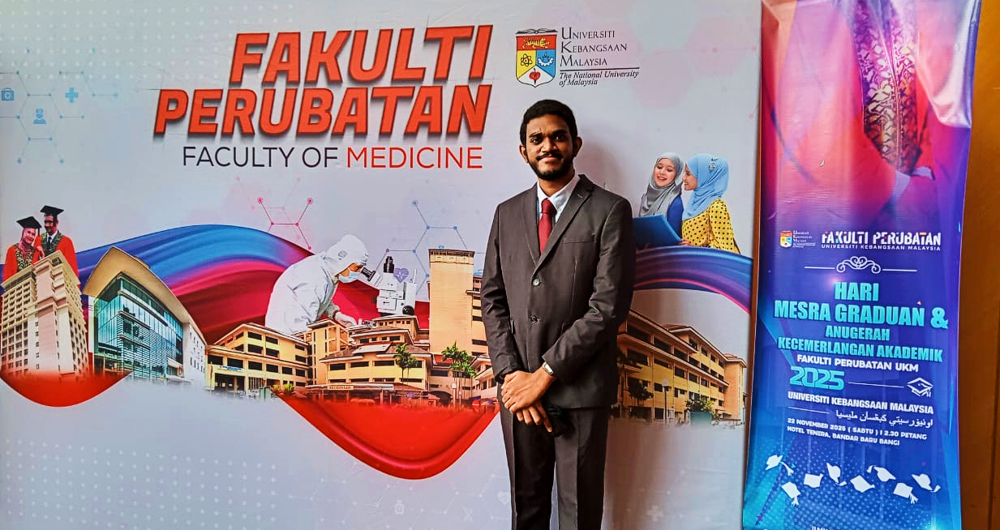
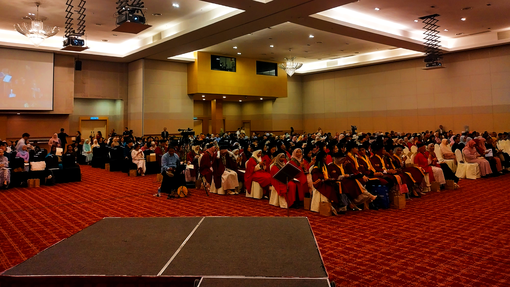

I am deeply honoured to have received the Dean's Award for both Semester 1 and Semester 2 of my second year of medical school.
The Dean's Award acknowledges students who demonstrate academic success during their studies at the
<a href="https://www.ukm.my/medicine/language/en/home-faculty-of-medicine-ukm" title="Learn more about the Faculty of Medicine, UKM." target="_blank" rel="noopener" class="external-link">Faculty of Medicine, UKM</a>.

The Dean's Awards Ceremony 2025 was a wonderful event, not only celebrating students' achievements but also commemorating the journey of the graduating class of 2025.
It was truly inspiring to be surrounded by so many driven and passionate peers.

A heartfelt thank you to all lecturers and faculty members for guiding me! I hope to continue making you proud in my future endeavours.

<i class="fa-solid fa-image" aria-hidden="true"></i>
*Pictures from the Dean's Award Ceremony 2025:*
<figure>
  
  <figcaption>Anitej receiving his Dean's Award.</figcaption>
</figure>
 
<figure>
  
  <figcaption>Anitej holding his Dean's Award.</figcaption>
</figure>
 
<figure>
  
  <figcaption>Anitej standing in front of the UKM Faculty of Medicine banner.</figcaption>
</figure>
 
<figure>
  
  <figcaption>The students and parents who attended the Dean's Award Ceremony 2025.</figcaption>
</figure>
<!--/sse-->
